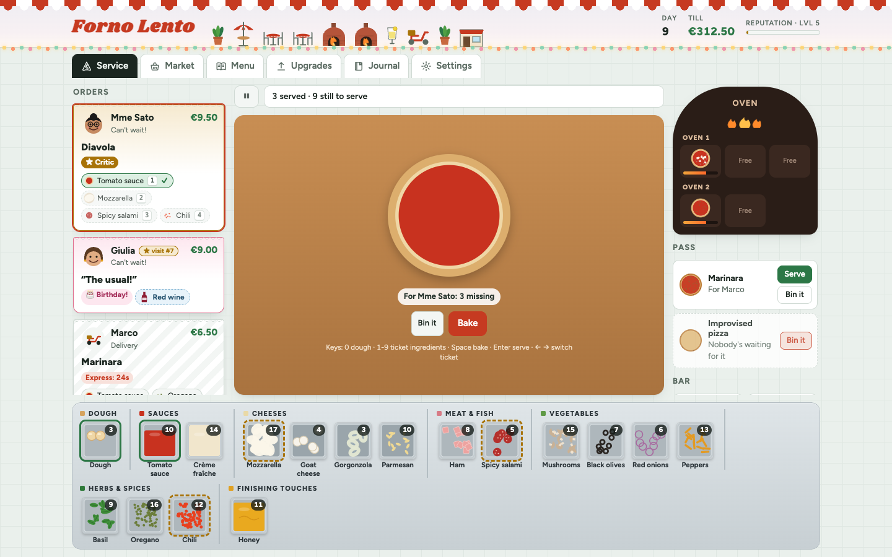
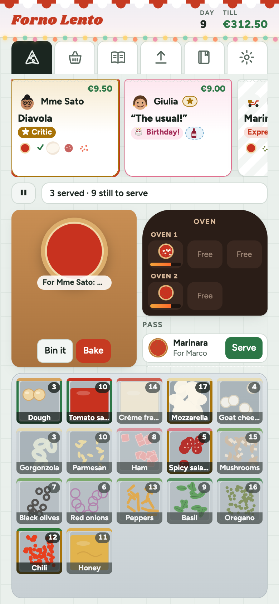
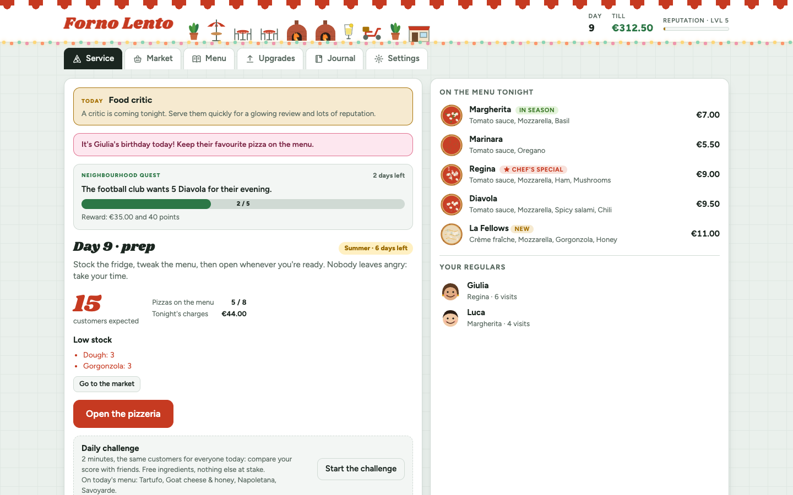
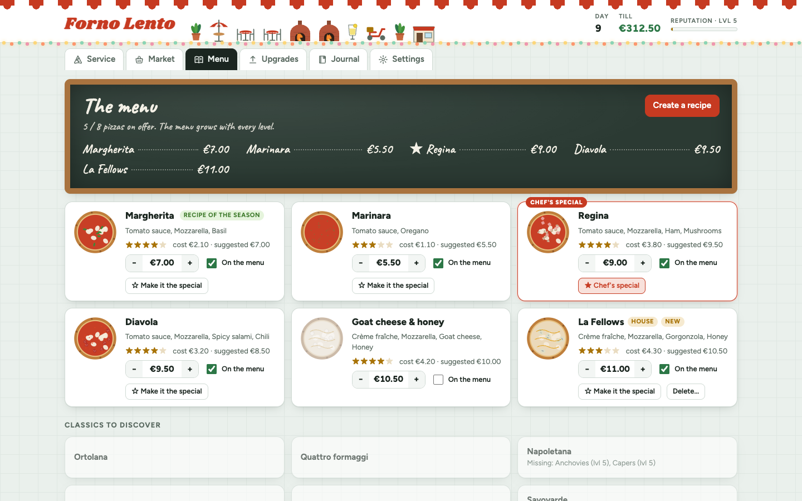
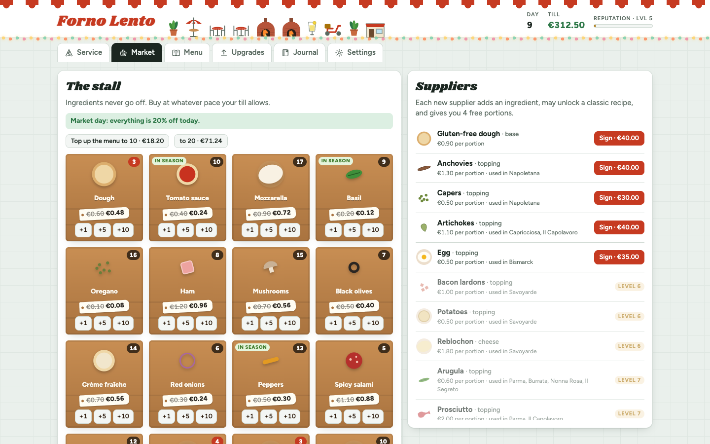
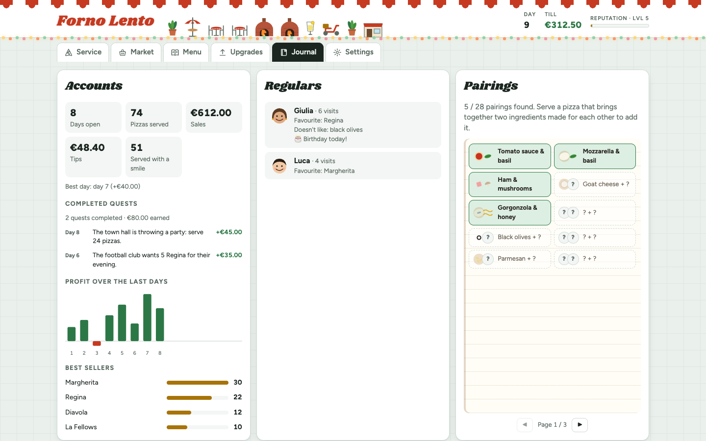

# Forno Lento

A laid-back pizzeria management game: no ads, no pressure.

### 🍕 [Play it now in your browser →](https://francebe.github.io/pizzeria-runner/)

Free, in English and French, on a computer or a phone (where it can also be installed as an app and played offline).

<p align="center">
  
</p>

<table>
  <tr>
    <td width="25%" rowspan="2" valign="top"></td>
    <td width="37%"></td>
    <td width="38%"></td>
  </tr>
  <tr>
    <td></td>
    <td></td>
  </tr>
</table>

## How to play

A day has three moments:

1. **Prep**: stock the fridge at the market, set the menu and its prices, then open.
2. **Service**: customers come in one by one. Build each order on the board (dough first, then the sauce, cheeses and
   toppings), bake it, then serve it from the pass.
3. **Closing**: a receipt sums up the day (sales, tips, purchases, evening charges, reputation earned).

Nobody ever leaves angry: customers just get hungrier (happy, then patient, then hungry, then starving, at 25, 50 and
90 seconds). Quick service makes tips more likely and more generous. The first day is guided step by step.

### Keyboard (desktop)

| Key | Action |
|---|---|
| `0` | Dough (gluten-free when the order asks for it) |
| `1`–`9` | The selected order's ingredients, numbered on its ticket (with help on) |
| `Space` | Bake |
| `Enter` | Serve (the selected customer's pizza first) |
| `←` `→` | Previous / next order |
| `Backspace` | Bin the pizza on the board |
| `O` | Offer the selected regular's drink (with the bar) |
| `P` or `Esc` | Pause |

## Rules

### Money

- **Sales**: each pizza is paid at its menu price, plus €1.50 for an extra topping and €1 for a delivery.
- **Tips** depend on the decor (30% of customers, +12 points per decor level), on the mood (happy customers tip more
  often and up to 30% more), on regulars, special requests, diets, offered drinks and rain. Never above 95%.
- **Perfect streak**: customers served while still happy, in a row, raise every tip: ×1.1 from 3, ×1.25 from 6, ×1.5
  from 10. A patient customer keeps the streak, a hungry one breaks it. It shows in the message line.
- **Hot pizzas**: a pizza left on the pass cools down (lukewarm after 25 seconds, cold after 50), and its tip with it.
- **Rush hour** (from level 3, on busy evenings): once in the evening, 40 seconds where customers pour in and tips double.
- **Evening charges**: €6, plus a little for each upgrade.
- **Debt**: if the till can't pay the charges, the rest goes on a tab, repaid automatically with half of the next sales.
- **Never stuck**: when nothing on the menu can be made and the till can't buy more, the game says so and offers a way
  out: borrow €30 from Nonna (once a day, on the tab), or close for today. In the morning, when the fridge and the till
  are both empty, Nonna also drops off enough for four margheritas, once a day.
- **Pause** (the ⏸ button, `P` or `Esc`) stops the clock. From the pause menu you can also close for today, or start the
  day over from this morning's prep.
- Baked pizzas nobody ordered can be binned one by one, or all at once.
- Ingredients never go bad. Pizzas still in the oven or on the pass at closing time are counted as waste.
- **The day's stars**: up to three each evening, one per goal: everyone served before getting hungry (and nobody sent
  home early), nothing binned, and a profit target that grows with the charges. Stars add up and unlock looks money
  can't buy (a starry gold awning at 15, a starry sign at 40, a starry night wall at 75).

### Reputation and levels

Every pizza served earns reputation: more for big pizzas, special requests, "the usual", birthdays, new pairings and
critics. There are **20 levels**: the first come quickly, then each takes noticeably longer from level 4 on. Each level
can unlock suppliers, upgrades and recipes, and lets the menu hold one more pizza (up to 12).

### The menu

- **Classics** join the recipe book as soon as all their ingredients are signed. **Nonna's secret recipes** come at
  levels 4, 7, 10 and 15; they are a little more appealing than the others.
- **House recipes**: create your own (up to 8 toppings, one sauce, or none for a white pizza). Appeal goes up with
  toppings, cheese and good pairings, down with clashes. **Desserts** (from level 6: chocolate spread, mascarpone,
  banana, strawberries, hazelnuts) need neither cheese nor sauce, but don't mix with meat or fish.
- **Price**: the suggested price covers the ingredients with a fair margin. Cheaper brings more orders, too expensive
  drives customers away.
- **Chef's special**: one recipe on the menu, ordered 1.5 times as often.
- **Pairings**: good pairings stay secret until you serve a pizza that has them; the recipe editor then shows them by
  name, and the journal collects them.

### Customers

- **The neighbourhood**: a name is a person, and everyone keeps their look (hair, accessories). About twenty people live
  nearby and come most of the time; everyone else passes by now and then.
- **Regulars**: someone from the neighbourhood who has ordered the same pizza three times, each time with at least
  three pizzas on the menu, becomes a regular: they often reorder it and tip more. There are at most eight at a time,
  so their usual stays something you can remember. Each has a profile in the journal: their favourite, one ingredient
  they never order, and a birthday. On their birthday they come for their favourite and leave a €5 gift. A regular who
  stays away more than 10 days is lost from sight, which makes room for someone else; back again, they may become one
  again.
- **"The usual"**: a regular ordering their favourite sometimes just says "the usual". The ticket hides the recipe and
  the help is off: remember it for a bonus, or tap "Remind me…" to see it, without the bonus.
- **Back for dessert**: with a dessert pizza on the menu, a customer served happy sometimes comes back later in the
  evening for one, on top of the day's customers. Served quickly, they add €1.50.
- **Special requests** (from level 3): an extra topping, or one left out.
- **Diets** (from level 4): vegetarian, no pork, gluten-free (with the gluten-free dough, signed at the market).
- **Tables** (from level 3): two to four people come in together. Serve the whole table while they are still happy or
  patient for a bonus of €1.50 each.
- **Drinks** (with the bar): some customers add a drink to their order. The bar sits in the board's left corner: a tap
  pours that drink, and each glass costs a little. If it is the selected customer's drink, it goes straight to them and
  is paid; otherwise it lands on the tray (right corner, three glasses at most), where a tap serves it to whoever
  ordered it. Nothing but the tickets tells which drink is wanted: a glass poured for nobody waits on the tray until
  someone orders it or the tray is cleared, and its cost is lost. Someone who got their pizza first waits at the counter,
  on a blue ticket, until their drink comes. A regular's drink can also be offered (before the pizza): the glass costs,
  nothing comes in, but a much better chance of a bigger tip, and a little reputation. At bar level 3, a barman serves
  the drinks on his own, one every 6 seconds, and never gets them wrong; pouring by hand is still quicker.
- **Celebrities** (from level 5, rare, at most one a day): they order the finest pizza on the menu with an extra
  topping, and leave a €10 tip, lots of reputation, and a signed photo that goes up on the front.
- Customers come in many faces: over 120 names, hairstyles and colours (now and then blue or green), and accessories
  (glasses, hats, headphones…). Names only shape the looks; diets and everything else are drawn at random.

### Days and the neighbourhood

- **Seasons** change every 7 days: their ingredients are 25% off, and a recipe of the season is ordered more often.
  They are the market's ("Summer market"), never the real weather or date: the game shows no calendar date at all,
  only its day number and, during service, the evening's clock (19:00 to about 23:00).
- **Events**, from day 3, about one day in two: market day (20% off), rain (fewer, more generous customers), street
  party (many more customers), sunshine (more customers, many more with a terrace) and the food critic, who comes in
  once that evening: serve them quickly for a glowing review and lots of reputation.
- **Incidents**, from day 5, each with something in return: a power cut (one oven, one pizza at a time, but bigger
  tips; a wood-fired oven keeps going, and when every oven burns wood it is a missing wood delivery instead), a late delivery (one ingredient arrives a minute into the service, with free portions), a health inspection
  (a day without binning anything earns lots of reputation) and a scooter strike (no deliveries, more people eating in).
- **Neighbourhood quests**, from day 4. **Group orders**: in the morning, someone books a big order for tonight
  (the football club wants 3 Regina and 2 Margherita…). A ticket comes in a little after opening; make the pizzas in any
  order, between customers. The faster the whole order is delivered, the better the medal and the pay (gold, silver,
  bronze); an order not finished by closing time pays half for what was delivered. Other quests last three days
  (serve so many smiling customers, discover a pairing…). No penalty when they run out. Rewards have their own line on
  the day's receipt, and completed quests are listed in the journal.
- **Weekly missions**: three goals each week (serve whole tables, reach a streak, earn tips…), €25 each from Nonna and
  €50 more for all three. They show on the morning screen.
- **Tonight's goal** (from day 2): one optional goal a day about how the evening is played, apart from the day's
  stars (hungry customers, waste, profit) and the week's missions (how much): every pizza served hot, the last customer
  served before 23:00, so many different pizzas, or customers served within 15 seconds of coming in. €12 and 15
  reputation when reached; nothing lost when missed. It shows in the morning, as 🎯 in the message line during
  service (how far it is, ✓ or ✗), and on the receipt.
- **Festivals** follow the real date: Halloween, Christmas and Valentine's Day each bring a festive ingredient (with
  free portions) and a recipe, for a few days. They say so ("For real, it's Halloween, until November 3"), and their
  ingredient and recipe wear the festival's emoji, so a Zucca at the summer market makes sense.

### Upgrades

| Upgrade | What it does |
|---|---|
| Oven | Two pizzas at once, then faster baking, then wood-fired: better pizzas, a tip more likely and a little more reputation |
| Dining room | More customers, one more order at the counter |
| Decor | More tips (and string lights) |
| Kitchen assistant | Rolls out fresh dough after each bake, then fades the pans the selected order doesn't need (a little, then more) |
| Tidy prep line | The pans no pizza on tonight's menu uses go in a drawer at the end of the line: a shorter line, but a request for an ingredient off the menu means opening it |
| Terrace | More customers, especially on sunny days |
| Delivery | Scooter orders, with an express bonus when they leave within 45 seconds |
| Bar | Drinks: lemonade and sparkling water, then chinotto and red wine, then a barman who serves them on his own |
| Second oven | One slow slot when built, then improving like the first oven, up to wood-fired. Two ovens of two pizzas: four at most, which is already a lot to keep up with |
| Second address | Brings in money every evening |

Any upgrade can be sold back, one level at a time and outside service, for 75% of what that level cost: for one that
doesn't suit the way you play. The tidy prep line, a pure comfort, is sold back for its full price. The comfort
features (the drawer, the assistant fading the pans) can also simply be switched off in Settings, for free.

Once the money piles up, the pizzeria's looks can be bought too: awning colours, a neon or gold-leaf sign, wall tiles.

### The journal

Accounts (profit chart, best sellers, best day, stars, best streak, completed quests), online reviews, regulars'
profiles, the pairings
book, and the achievements. 34 of them can be earned by playing (one stays hidden until then); the last one keeps its
secret.

**Online reviews** (on Gustoscope, a made-up site): every evening, a few customers rate the pizzeria from 1 to 5 stars.
A quick, hot pizza earns 5; a long wait or a pizza left to cool on the pass costs stars, more or less depending on the
customer's temper (some forgive a lot, some nothing), and the review talks about the worst of it, in the tone of its
stars. Unhappy customers write more often than happy ones, and the overall rating counts every review ever written:
it drops faster than it climbs back. It shows in the header as five stars, filled as far as the rating goes. Food
critics write in the papers instead (made-up ones too), under "In the papers". Only for show: reviews and articles
change nothing in the game.

### Daily challenge

Two minutes, free ingredients, and the same customers in the same order for everyone who plays on that date, whatever
they have unlocked. Points for each pizza, more for big ones and happy customers. Nothing else is at stake. Share copies
a result to paste to friends.

### Everything else

- **Music and sound effects**: background music, the oven's sizzle while a pizza bakes, a bell for each new order and a
  till for each payment. Music and effects each have their own volume and mute button in Settings; the music softens
  during a pause. Sound starts with the first tap or click, as browsers require.
- Light or dark theme, larger text, and a shareable image of the day's receipt (Settings, receipt).
- The game installs as an app and plays offline.
- Have you tried every combination of keys (or of swipes)? Nonna has. And she doesn't share her secrets with just anyone: perhaps
  with someone who has served every one of hers. Mamma keeps something in a jar too, for those whose books balance day
  after day. Once shared, a secret is made at the market and goes on a pizza from the prep line (or with `S` and `M`).

## Running locally

Requires Node 18 or later (`nvm use` picks up the version from `.nvmrc`).

```bash
npm install
npm run dev
```

Then open the address shown in the terminal (http://localhost:5173).

To try it on your phone, run `npm run dev:phone` instead: Vite also prints a network address (http://192.168.x.x:5173)
to open on the phone, on the same Wi-Fi. The development server is then reachable by everyone on that network,
so stop it once you're done (the deployed game doesn't have this concern).

## Building a static version

```bash
npm run build
```

The `dist/` folder can be hosted anywhere (Netlify, GitHub Pages, Vercel…).

## Tests and checks

```bash
npm test            # run the tests once
npm run test:watch  # re-run on every change
npm run typecheck   # TypeScript, strict mode
npm run lint        # ESLint (npm run lint:fix to auto-fix)
npm run check       # types + lint + tests + build, like the CI
```

- **Pre-commit hook** (husky, installed by `npm install`): lints the staged files with auto-fix, type-checks, then runs the tests.
  A failure blocks the commit; `git commit --no-verify` skips it in an emergency.
- **CI** (`.github/workflows/ci.yml`): types, lint, tests and build on every push and pull request to `main`.
- **Deployment** (`.github/workflows/deploy.yml`): every push to `main` that passes the same checks goes live on GitHub Pages.
- **Test game** (`src/dev/`, `npm run dev` only): Settings gets a panel to set up a game at any level, with any
  suppliers, upgrades and secrets, to try how it plays later on. "Generate the code" gives a save code to paste in the
  deployed game, on a phone for instance. The panel is left out of the built game.

## Where things live

```
src/
  data/         game data, no logic
  game/         game rules, no React (tested); types.ts describes the state and every action
    actions/    what each player action does
  components/   reusable drawings (pizza, ingredients, faces)
  views/        screens
  hooks/        game clock, autosave
  i18n/         every piece of text, in French (fr.ts) and English (en.ts)
  utils/        formatting, maths, randomness, save codes
```

- `data/ingredients.ts`: `INGREDIENTS` (price, required level, supplier fee, drawing) and `PREP_STATIONS` (order of the pans on the prep line)
- `data/recipes.ts`: `CLASSIC_RECIPES`, plus `GOOD_PAIRINGS` / `BAD_PAIRINGS` that affect recipe appeal
- `data/progression.ts`: `REPUTATION_THRESHOLDS` (XP per level), `UPGRADES`, `OVEN_SLOTS`, `BAKE_SECONDS`
- `game/pizza.ts`: `fairPrice`, `appealOf`, `priceAttractiveness`
- `game/economy.ts`: `forecastCustomers`, `dailyCharges`, debt handling
- `game/customers.ts`: what customers order, special requests, critics, deliveries, "the usual"
- `game/actions/serviceActions.ts` + `game/serving.ts`: the service, and what happens when an order is served (payment, tips, bonuses, reputation)
- `data/events.ts` + `game/events.ts`: daily events and market prices
- `data/seasons.ts` + `game/seasons.ts`: seasons, in-season ingredients and recipes
- `data/drinks.ts`, `data/quests.ts`, `data/cosmetics.ts`: the bar, neighbourhood quests, the pizzeria's looks
- `game/challenge.ts`: the daily challenge, seeded by the date
- `game/diets.ts`, `game/quests.ts`, `game/regulars.ts`: diets, quests, regulars' profiles and birthdays
- `game/batch.ts` + `game/evening.ts`: group orders, rush hour and late deliveries over an evening
- `game/streak.ts`, `game/stars.ts`, `game/weekly.ts`, `game/calendar.ts`: streaks and cooling pizzas, the day's stars,
  weekly missions, calendar festivals
- `data/tonight.ts` + `game/tonight.ts`, `game/clock.ts`: tonight's goal, the evening's clock
- `game/simulation.test.ts`: a robot plays many full days with everything on, to catch what only shows when it all mixes
- `data/customers.ts` + `game/looks.ts`: names, hair, hairstyles and accessories
- `assets/sounds/`: the music and sound effects; `audio/engine.ts` plays them (Web Audio, seamless loops, live fades),
  `audio/cues.ts` decides what plays when. The music comes as Ogg and as AAC (`music.m4a`, for older iPhones); after
  replacing `music.ogg`, rebuild the AAC copy with `afconvert music.ogg -o music.m4a -f m4af -d aac -b 128000` (macOS)
- `data/achievements.ts` + `game/achievements.ts`: achievements and their progress
- `game/pairings.ts`: pairing discovery

Ids (`pate`, `margherita`, `salle`…) are stored in save files: don't rename them.

## Languages

The game is in French and English. It starts in the browser's language and can be switched in Settings.

All text lives in `src/i18n/fr.ts` and `src/i18n/en.ts`. French is the reference: its keys, `{placeholders}` and
function signatures define the types, so a misspelt key, a missing param or an English entry out of shape fails to compile.
Components get a translator with `const t = useTranslation()`, then call `t("prep.title", { day: 3 })`.
Entries are either strings with `{placeholders}` or functions, for plurals and amounts of money.

Game logic never produces text: it stores translation keys (for example, toasts are `{ key, params }`),
so everything follows a language change immediately.

## Offline and install

`public/sw.js` is a service worker, registered in built versions only. The build (`vite.config.ts`) writes a build id
and the list of built files into it, so each deployment caches its own files and drops the previous ones.
The manifest and icons are in `public/`; `icon.svg` is the source of the PNG icons.

## Saves

The game is stored in the browser's `localStorage`, which is specific to each address.
To continue a game started elsewhere: Settings > Generate code, then paste it under Load a code on the other device.

If the game ever fails to render (say, a damaged save loaded from a code), a recovery screen offers to start over;
the broken save is kept aside in `localStorage` under `forno-lento-broken-save`.

If you change the shape of the saved state, bump `SAVE_VERSION` in `game/state.ts` and add the conversion
to `migrateSave`, so existing games still load.

## Multiplayer

The "Multiplayer" tab: one player creates a room and reads out its four-letter code, the others join with it, and the
host starts. No accounts: a nickname and a room code. Nothing is at stake for anyone's own pizzeria. For a challenge or a quick
co-op, the host picks the length in the lobby: a 1-minute sprint, the daily challenge's 2 minutes, or 5 minutes. Anyone
can leave the room, in the middle of a match too (after a confirmation: there is no coming back into it).

- **Challenge** (2 to 4 players): everyone plays the same customers on the same clock, each on their own phone,
  like the daily challenge, with the others' scores in the message line and a podium at the end.
- **Pizza Royale** (2 to 4 players): the challenge in sudden death. Baking a pizza nobody is waiting for (counting
  those already in the oven or on the pass) or throwing anything away puts a player out; customers come faster and
  faster (up to 2.5 times by the end). The last one in the kitchen wins, with a crown, a rain of slices and a little
  fanfare played by the browser itself; after 5 minutes, the best score among those still in wins.
- **Co-op** (2 players): one kitchen for two, run on the host's phone and apart from both players' pizzerias (two ovens
  of two pizzas, the challenge's recipes, endless pans). Each has their own board; the order the other one is making
  wears their colour and name, so the same pizza isn't made twice. One team score at the end. The host's phone sends
  the kitchen to the other one a few times a second, and the other one's moves come back to it (`src/multiplayer/coop.ts`).
- **Duo pizzeria** (2 players): a whole pizzeria run by two, day after day, like Minecraft's worlds. It is kept in the
  host's browser, apart from the solo game (`src/multiplayer/duoSaves.ts`), and the partner's browser keeps a copy at
  each new day and when the session ends, so either one can host it next time with the most recent copy. While a duo
  pizzeria is open, the header (with a "🤝 Duo" badge on the sign) and the service, market, menu, upgrades and journal
  tabs show it; the settings and multiplayer tabs stay the player's own. Both cook on their own board, serve drinks
  and restock; the host makes the big decisions (upgrades, the menu, suppliers, opening, the next day), and the
  partner is told so if they try. There is no clock: it stays open as long as the host keeps it open, and both need
  to be there to play it (two copies played apart would drift away from each other).

Every move the other phone sends is checked on the host's, its kind and its values (`isCoopMove`, `isPartnerDuoMove`):
anything a button of the game couldn't send, like buying -1000 mozzarellas, is ignored.

Scores are checked by the server too (`isPlausibleScore` in `src/multiplayer/protocol.ts`): no more pizzas than
customers could have come by then, no more points than those pizzas could be worth, never going down, nothing before
the start. A score that can't be true is not taken (the player keeps their last one that could be); the game's tests
check those limits against the game's own rules. Going out of a Pizza Royale is final. What the server can't check is
a tampered phone that keeps quiet about its own mistake, or plays perfectly within the limits: that would take the
server playing every match itself.

A phone drops its connection whenever its player switches apps (to send the room code, to answer a message). That is
not leaving: the player is shown as away to the others and keeps their place for 3 minutes, and their phone comes back
on its own, into a match already started too, with a secret the server gave it alone. A phone back on screen checks its
connection at once (a quick ping the server answers without waking the room) rather than trusting one that died
silently. Leaving with the button, or staying away longer, is leaving.

It needs a small server, in `server/`: a Cloudflare Worker with one Durable Object per room. A room code is the name of
its Durable Object, and Cloudflare runs exactly one per name, handling one request at a time: two rooms can never share
a code. Rooms close after 10 minutes without activity; a finished room's code stays blocked 10 more minutes, so a late
player gets "this match is over" rather than strangers' new room. Each player is limited to 20 messages a second, and
only the game's own addresses may use the server (`ALLOWED_ORIGINS` in `server/wrangler.toml`). Each address may
create rooms and open connections at most 30 times a minute (`JOIN_LIMIT`, Cloudflare's rate limiting), and a room's
creation request is a few bytes at most.

**Try it locally**

```bash
cd server && npm install && cd ..
npm run server:dev   # the server, on http://localhost:8787
npm run dev          # the game, which uses that server in development
```

Open the game in two windows (or a private one) and play against yourself. For a phone on the same Wi-Fi, run
`npm run dev -- --host`, copy `server/.dev.vars.example` to `server/.dev.vars` so the server accepts any address, and
give the game the server's address on your network: `VITE_MULTIPLAYER_URL=http://192.168.x.x:8787 npm run dev -- --host`.

**Put it online** (Cloudflare's free plan: past its daily quota, requests fail until the next day, nothing is billed)

1. `cd server && npx wrangler login`, then `npx wrangler deploy`. It prints the server's address, like
   `https://forno-lento-rooms.<your-subdomain>.workers.dev`.
2. Give that address to the game: in GitHub, Settings > Secrets and variables > Actions > Variables, add
   `VITE_MULTIPLAYER_URL` with it. The deployment (`.github/workflows/deploy.yml`) passes it to the build, which also
   adds it to the page's Content-Security-Policy. The next push to `main` goes live with multiplayer.
3. Without that variable, the tab just says multiplayer is coming: the game never depends on the server.

## Privacy and security

- Nothing about the player leaves the browser: the game and its saves live in `localStorage`, and save codes are only
  copied and pasted by hand. In multiplayer, only a nickname, a room code and scores (or the shared kitchen) go through
  the server, and a room is forgotten minutes after it ends.
- The fonts (Figtree, Shrikhand, Caveat, all under the SIL Open Font License) ship with the game (`src/fonts.ts`, from
  Fontsource), rather than being loaded from Google: no visitor's address goes to a font service.
- Visits are counted with Cloudflare Web Analytics (the script at the end of `index.html`): no cookies, no personal
  data, no tracking across sites.
- Built versions carry a Content-Security-Policy (see `vite.config.ts`): the page may only load its own files and the
  analytics script, and only send data to itself, Cloudflare's analytics and the multiplayer server. It is added at build time,
  since the dev server needs an inline script for hot reload. A new third-party resource has to be added there too.
- The page never inserts HTML from strings: everything shown, the pizzeria's name included, goes through React.
