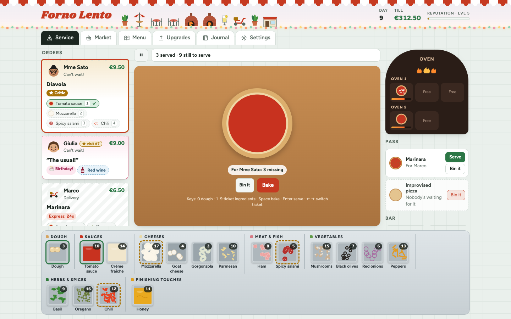
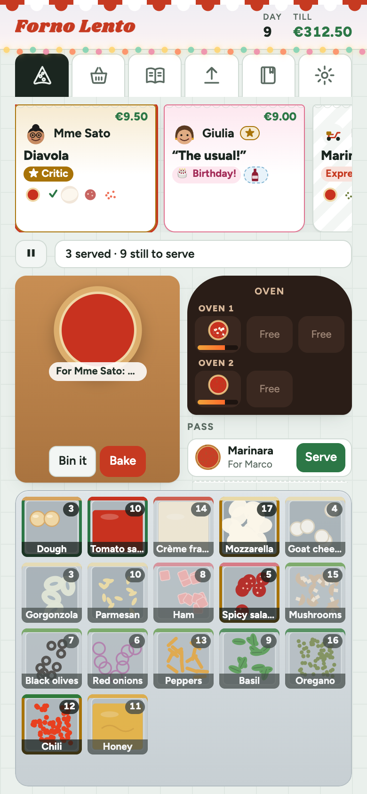
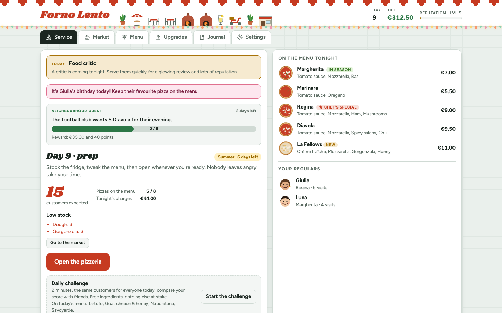
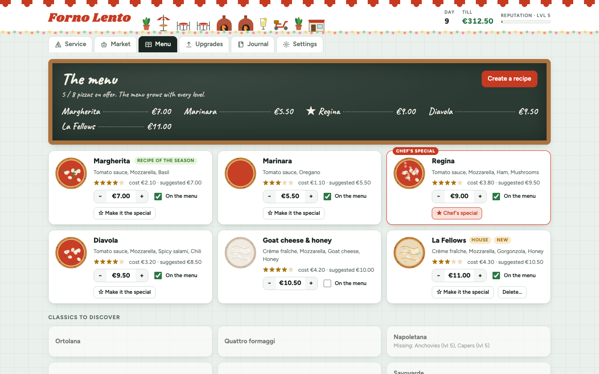
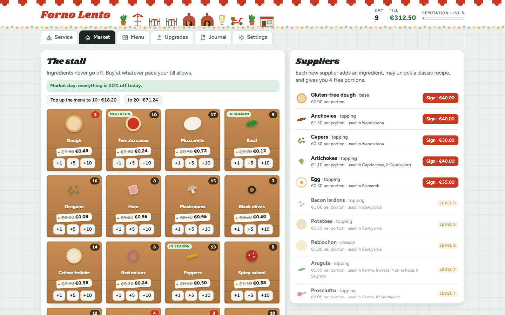
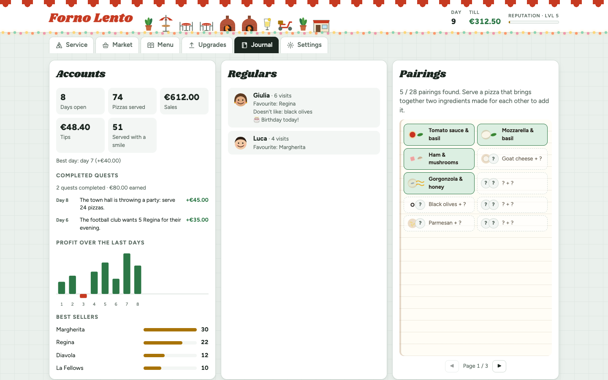

# Forno Lento

A laid-back pizzeria management game: no ads, no pressure.

### 🍕 [Play it now in your browser →](https://francebe.github.io/pizzeria-runner/)

Free, in English and French, on a computer or a phone (where it can also be installed as an app and played offline).

Forno Lento is the way in. Next to it, each at its own address and with its own save (the game's Settings link to
them, under Other modes):

- a plain solitaire with a pizza deck, free and without ads, on a phone or a computer:
  [francebe.github.io/pizzeria-runner/solitaire/](https://francebe.github.io/pizzeria-runner/solitaire/) (see
  [The solitaire](#the-solitaire));
- **Forno Infinito**, the factory mode (beta), from one pizza to a chain of restaurants, and later to factories and
  beyond: [francebe.github.io/pizzeria-runner/factory/](https://francebe.github.io/pizzeria-runner/factory/) (see
  [Forno Infinito](#forno-infinito-the-factory-mode)).

<p align="center">
  
</p>

<table>
  <tr>
    <td width="25%" rowspan="2" valign="top"></td>
    <td width="37%"></td>
    <td width="38%"></td>
  </tr>
  <tr>
    <td></td>
    <td></td>
  </tr>
</table>

## How to play

A day has three moments:

1. **Prep**: stock the fridge at the market (by hand, or topping up what the menu needs to 10, 20 or 30 portions), set the menu and its prices, then open.
2. **Service**: customers come in one by one. Build each order on the board (dough first, then the sauce, cheeses and
   toppings), bake it, then serve it from the pass.
3. **Closing**: a till receipt sums up the day. Its header gives the day's event and stars; then the service (pizzas
   served, the best seller, new reviews, what was binned, every order folded away), the till (money in: sales, tips,
   quests and group orders, bonuses, the second address; money out: purchases and charges; the day's profit, which
   counts everything the till took in, and what is still owed), and the round-up (the stars' three goals, tonight's
   goal, the mystery guest, the inspection, reputation earned and a new level).

Nobody ever leaves angry: customers just get hungrier (happy, then patient, then hungry, then starving, at 25, 50 and
90 seconds). Quick service makes tips more likely and more generous. The first day is guided step by step.

### Keyboard (desktop)

| Key | Action |
|---|---|
| `0` | Dough (gluten-free when the order asks for it) |
| `1`–`9` | The selected order's ingredients, numbered on its ticket (with help on) |
| `Space` | Bake |
| `Enter` | Serve (the selected customer's pizza first) |
| `←` `→` | Previous / next order |
| `Backspace` | Bin the pizza on the board |
| `O` | Offer the selected regular's drink (with the bar) |
| `P` or `Esc` | Pause |

## Rules

### Money

- **Sales**: each pizza is paid at its menu price, plus €1.50 for an extra topping and €1 for a delivery.
- **Tips** depend on the decor (30% of customers, +12 points per decor level), on the mood (happy customers tip more
  often and up to 30% more), on regulars, special requests, diets, offered drinks and rain. Never above 95%.
- **Perfect streak**: customers served while still happy, in a row, raise every tip: ×1.1 from 3, ×1.25 from 6, ×1.5
  from 10. A patient customer keeps the streak, a hungry one breaks it. It shows in the message line.
- **Hot pizzas**: a pizza left on the pass cools down (lukewarm after 25 seconds, cold after 50), and its tip with it.
- **Rush hour** (from level 3, on evenings of at least 8 customers, not on a match night): 40 seconds where customers
  pour in and tips double, at a time drawn in the morning between 20:15 and 21:15. It is announced in the morning
  ("On tonight"), shown in the message line during service (🔥 20:45), and the kitchen is warned 15 minutes before.
- **The shape of an evening**: customers come a little more slowly until 19:40 and after 22:15, a little faster in
  between; an evening lasts about as long on the whole.
- **Evening charges**: €6, plus a little for each upgrade.
- **Debt**: if the till can't pay the charges, the rest goes on a tab, repaid automatically with half of the next sales.
- **Never stuck**: when nothing on the menu can be made and the till can't buy more, the game says so and offers a way
  out: borrow €30 from Nonna (once a day, on the tab), or close for today. In the morning, when the fridge and the till
  are both empty, Nonna also drops off enough for four margheritas, once a day.
- **Pause** (the ⏸ button, `P` or `Esc`) stops the clock. From the pause menu you can also close for today, or start the
  day over from this morning's prep.
- Baked pizzas nobody ordered can be binned one by one, or all at once.
- Ingredients never go bad. Pizzas still in the oven or on the pass at closing time are counted as waste.
- **The day's stars**: up to three each evening, one per goal: everyone served before getting hungry (and nobody sent
  home early), nothing binned, and a profit target that grows with the charges. Stars add up and unlock looks money
  can't buy (a starry gold awning at 15, a starry sign at 40, a starry night wall at 75).

### Reputation and levels

Every pizza served earns reputation: more for big pizzas, special requests, "the usual", birthdays, new pairings and
critics. There are **20 levels**: the first come quickly, then each takes noticeably longer from level 4 on. Each level
can unlock suppliers, upgrades and recipes, and lets the menu hold one more pizza (up to 12).

### The menu

- **Classics** join the recipe book as soon as all their ingredients are signed. **Nonna's secret recipes** come at
  levels 4, 7, 10 and 15; they are a little more appealing than the others.
- **House recipes**: create your own (up to 8 toppings, one sauce, or none for a white pizza), or, with the trattoria
  open, a plate of pasta (one pasta, then the same rules). Appeal goes up with
  toppings, cheese and good pairings, down with clashes. **Desserts** (from level 6: chocolate spread, mascarpone,
  banana, strawberries, hazelnuts) need neither cheese nor sauce, but don't mix with meat or fish.
- **Price**: the suggested price covers the ingredients with a fair margin. Cheaper brings more orders, too expensive
  drives customers away.
- **A slice for the queue**: a pizza nobody ordered can be cut into slices for the customers waiting instead of
  going in the bin. Nothing counts as waste, and everyone waiting gets 20 seconds of patience back, once each per evening
  (not in challenges, where ingredients are free; `game/slice.ts`).
- **Themed nights** (events): a veggie night or a white pizza night, when the recipe book has something for it. Those
  pizzas are ordered 2.5 times as often and pay 15% more; with two of them on the menu, 20% more people come, with none,
  10% fewer (`game/themes.ts`).
- **The evening's pace** adapts, discreetly: after three hard evenings (fewer than half the customers leaving happy),
  customers come 20% more slowly and wait 15% more patiently; after three easy ones (three stars and 90% happy), they
  come 10% faster. Never in challenges (`game/difficulty.ts`).
- **Morning tips**, behind a 💡 bubble with their count on the prep screen: what tonight will need from the fridge
  (beyond the low stock list), prices far from the suggested one, pizzas nobody ever orders, room left on the menu, an
  upgrade within reach (`game/tips.ts`).
- **Special of the week**: one pizza of the menu, picked in the morning (with the stars of tonight's menu, or from the
  Menu tab) for the whole week. It is ordered twice as often, pays a fifth of its price on top when served before the
  customer gets impatient, and brings 3 more reputation when it is a homemade recipe. It can be changed on the morning it
  was picked only, or once it leaves the menu. When the week ends, a toast tells how many went out, and a new one is to be
  picked (`game/special.ts`).
- **Pairings**: good pairings stay secret until you serve a pizza that has them; the recipe editor then shows them by
  name, and the journal collects them.

### Customers

- **The neighbourhood**: a name is a person, and everyone keeps their look (hair, accessories). About twenty people live
  nearby and come most of the time; everyone else passes by now and then.
- **Regulars**: someone from the neighbourhood who has ordered the same pizza three times, each time with at least
  three pizzas on the menu, becomes a regular: they often reorder it and tip more. There are at most eight at a time,
  so their usual stays something you can remember. Each has a profile in the journal: their favourite, one ingredient
  they never order, and a birthday. On their birthday they come for their favourite and leave a €5 gift. A regular who
  stays away more than 10 days is lost from sight, which makes room for someone else; back again, they may become one
  again.
- **"The usual"**: a regular ordering their favourite sometimes just says "the usual". The ticket hides the recipe and
  the help is off: remember it for a bonus, or tap "Remind me…" to see it, without the bonus.
- **Back for dessert**: with a dessert pizza on the menu, a customer served happy sometimes comes back later in the
  evening for one, on top of the day's customers. Served quickly, they add €1.50.
- **Special requests** (from level 3): an extra topping, or one left out.
- **Diets** (from level 4): vegetarian, no pork, gluten-free (with the gluten-free dough, signed at the market).
- **Tables** (from level 3): two to four people come in together. Serve the whole table while they are still happy or
  patient for a bonus of €1.50 each.
- **Drinks** (with the bar): some customers add a drink to their order. The bar sits in the board's left corner: a tap
  pours that drink, and each glass costs a little. If it is the selected customer's drink, it goes straight to them and
  is paid; otherwise it lands on the tray (right corner, three glasses at most), where a tap serves it to whoever
  ordered it. Nothing but the tickets tells which drink is wanted: a glass poured for nobody waits on the tray until
  someone orders it or the tray is cleared, and its cost is lost. Someone who got their pizza first waits at the counter,
  on a blue ticket, until their drink comes. A regular's drink can also be offered (before the pizza): the glass costs,
  nothing comes in, but a much better chance of a bigger tip, and a little reputation. At bar level 3, a barman serves
  the drinks on his own, one every 6 seconds, and never gets them wrong; pouring by hand is still quicker.
- **Celebrities** (from level 5, rare, at most one a day): they order the finest pizza on the menu with an extra
  topping, and leave a €10 tip, lots of reputation, and a signed photo that goes up on the front.
- **Rare lines**: about one customer in forty says something unexpected (twelve lines) instead of their mood's line,
  while still in a good mood.
- **A perfect pizza**: straight from the oven (under 2 seconds on the pass) to someone still happy, served within 15
  seconds of coming in (a slice for the queue gives patience, not time): a golden "✨ Perfect!" bursts in the middle of
  the screen, and the receipt counts them.
- Customers come in many faces: over 120 names, hairstyles and colours (now and then blue or green), and accessories
  (glasses, hats, headphones…). Names only shape the looks; diets and everything else are drawn at random.

### Days and the neighbourhood

- **Seasons** change every 7 days: their ingredients are 25% off, and a recipe of the season is ordered more often.
  They are the market's ("Summer market"), never the real weather or date: the game shows no calendar date at all,
  only its day number and, during service, the evening's clock (19:00 to about 23:00).
- **Events**, from day 3, about one day in two: market day (20% off), rain (fewer, more generous customers), street
  party (many more customers), sunshine (more customers, many more with a terrace) and the food critic, who comes in
  once that evening: serve them quickly for a glowing review and lots of reputation.
- **Incidents**, from day 5, each with something in return: a power cut (one oven, one pizza at a time, but bigger
  tips; a wood-fired oven keeps going, and when every oven burns wood it is a missing wood delivery instead), a late delivery (one ingredient arrives a minute into the service, with free portions), a health inspection
  (a day without binning anything earns lots of reputation) and a scooter strike (no deliveries, more people eating in).
- **More incidents and visits** (`game/incidents.ts`, `game/family.ts`):
  - the fridge breakdown (from day 6, with an ingredient of the menu well stocked): pizzas using the best-stocked one are
    ordered twice as much; at closing, half of what is left of it is lost, on the receipt but not counted as waste;
  - the heatwave (summer market only, from day 5): 10% more customers, the terrace as on a sunny day, twice as many
    drinks ordered, waiting 15% harder to bear, slightly bigger tips;
  - the water cut (with a bar, from day 5): no drinks tonight (the bar is put away), and bigger tips;
  - Nonna's family (from day 8, with tables): a table of four comes at 20:45 (or as soon as nobody else is left to
    come), on top of the evening's customers, for Nonna's recipes on the menu (or a margherita). All served happy or
    patient: €20 and 30 reputation on top of the table bonus. They never join the customer book, and the evening waits
    for them (closing early still ends it).
- **A day holds at most three things out of the ordinary** (`game/dayLoad.ts`): the day's event, the competitor, a
  regular's story chapter, a birthday, a running quest (the wedding and its banquet count once). Tonight's goal, the
  rush and real-calendar festivals don't count. Birthdays and story chapters keep their dates; once a day is full,
  nothing new starts that morning (no event, new story, competitor or quest).
- **Evenings with a time**, from day 4, on the evening's clock: the match on TV kicks off at 21:00 (customers come
  more slowly while everyone watches), then the whole street comes in at half-time, around 21:45, for 30 seconds of
  quick succession and doubled tips (instead of the evening's usual rush). The wedding (from day 6, never while a quest
  runs): the newlyweds' banquet comes in at 21:00, a group order of 8 to 12 pizzas (more for a bigger pizzeria) paid
  half as much again, with a few fewer customers besides. Every evening, the kitchen is told when the last customer
  comes in.
- **Regulars with a story** (from level 4): now and then, in the morning, a regular starts a story of four chapters,
  each a visit a few days after the last: "The sweethearts" (a first date, a proposal, the engagement, back with the
  baby), "The exams" (revising, the results, the degree with the whole class, the first pay slip) and "The old
  brigade" (someone from the trade, grumpy, won over little by little). On a chapter's evening the regular comes for
  sure, sometimes with company as a table; it is announced in the morning, their ticket wears the story and says
  their line, and serving them turns the page (a little reputation, a reward for the last chapter). A chapter missed
  comes again later. Two stories at a time at most, each lived once a game; the journal tells each regular's story so
  far. Regulars expected on an evening (birthdays, stories) always come: their seats are kept, so a table never takes
  the last ones. In the morning's list, a story's tile opens on what it is about and what happened so far. **The story
  album** (journal, regulars) gives each story a page: the regular's face, an introduction, and each chapter lived as a
  photo (what happened, what they said, the day), the next one "to be continued" (or "tonight!"), those to come blank
  (`src/views/StoryAlbum.tsx`).
- **The competitor across the street** (from level 5 and day 12, now and then, at most once every 20 days): a
  made-up chain opens for three days. With an online rating of 4.3 ★ or more, customers stay loyal; from 3.5, about
  10% fewer come; below (or without reviews), about 20% fewer. Six of the day's stars over its three evenings and it
  throws in the towel: 50 reputation, and its customers come to try the pizzeria (about 10% more for two days).
  Otherwise it settles in, with no effect past its days. The morning's list and the receipt say where things stand.
- **The journal** on a phone: tabs (accounts, reviews, regulars, pairings, postcards, achievements, each with what it
  holds at a glance) show one part at a time, the last one chosen remembered on the device; from a tablet up,
  everything at once.
- **Postcards**: sixteen to collect in the journal, one for each rare moment the first time it happens (a rush, a
  street party, a power cut, a three-star day, a delighted critic, a celebrity, a match's half-time, the wedding
  banquet, five stars from the mystery guest, the competitor giving up, each regular's story told to its end, and
  each real-calendar festival). Face up, a scene on its sky, a stamp, a handwritten caption and the day it came; face
  down, a hint.
- **The mystery guest** (from day 7): an inspector from the guide, incognito among the first customers of the
  evening (someone on their own, passing by: never a regular, a table, a critic or a delivery). Nothing gives them away
  during service. The receipt unmasks them: five stars, one less for each mood they had reached when served, one or
  two less for a lukewarm or cold pizza, one if still waiting when the kitchen closes early. Five stars bring 60
  reputation and €25, four 40 and €12, three 20; from three, their verdict comes out in the papers.
- **Group orders hold the evening**: it isn't over while tonight's group order is still to come or incomplete; with
  nobody else left, it comes in at once. One that can no longer be completed (a recipe of it deleted) holds nothing,
  and closing early always gives up on it, paid for what arrived.
- **The morning's list**, "On tonight": the day's event, a real-calendar festival, tonight's goal, the neighbourhood
  quest and birthdays, as small tiles side by side (two on a phone, more on a wider screen: icon, name, a time or a
  deadline), each tapped open across the whole width for what it says, rather than a stack of banners.
- **Neighbourhood quests**, from day 4. **Group orders**: in the morning, someone books a big order for tonight
  (the football club wants 3 Regina and 2 Margherita…). A ticket comes in a little after opening; make the pizzas in any
  order, between customers. The faster the whole order is delivered, the better the medal and the pay (gold, silver,
  bronze); an order not finished by closing time pays half for what was delivered. Other quests last three days
  (serve so many smiling customers, discover a pairing…). No penalty when they run out. Rewards have their own line on
  the day's receipt, and completed quests are listed in the journal.
- **Weekly missions**: three goals each week (serve whole tables, reach a streak, earn tips…), €25 each from Nonna and
  €50 more for all three. They show on the morning screen.
- **Tonight's goal** (from day 2): one optional goal a day about how the evening is played, apart from the day's
  stars (hungry customers, waste, profit) and the week's missions (how much): every pizza served hot, the last customer
  served before 23:00, so many different pizzas, or customers served within 15 seconds of coming in. €12 and 15
  reputation when reached; nothing lost when missed. It shows in the morning, as 🎯 in the message line during
  service (how far it is, ✓ or ✗), and on the receipt.
- **Festivals** follow the real date: Halloween, Christmas and Valentine's Day each bring a festive ingredient (with
  free portions) and a recipe, for a few days. They say so ("For real, it's Halloween, until November 3"), and their
  ingredient and recipe wear the festival's emoji, so a Zucca at the summer market makes sense.

### Upgrades

| Upgrade | What it does |
|---|---|
| Oven | Two pizzas at once, then faster baking, then wood-fired: better pizzas, a tip more likely and a little more reputation |
| Dining room | More customers, one more order at the counter |
| Decor | More tips (and string lights) |
| Kitchen assistant | Rolls out fresh dough after each bake, then fades the pans the selected order doesn't need (a little, then more). A person, named when hired, who tires (see below) |
| Tidy prep line | The pans no pizza on tonight's menu uses go in a drawer at the end of the line: a shorter line, but a request for an ingredient off the menu means opening it |
| Terrace | More customers, especially on sunny days |
| Delivery | Scooter orders, with an express bonus when they leave within 45 seconds |
| Bar | Drinks: lemonade and sparkling water, then chinotto and red wine, then a barman who serves them (see the staff) |
| Floor staff | Someone takes ready pizzas to the tables on their own, every 8 then 5 seconds (see the staff) |
| Second oven | One slow slot when built, then improving like the first oven, up to wood-fired. Two ovens of two pizzas: four at most, which is already a lot to keep up with |
| Trattoria | From level 9: plates of pasta (see below). The stove gets 2 burners at 6 seconds, then 3 at 4.5 seconds (level 11); the menu holds 4 more dishes |
| Second address | Brings in money every evening |

Any upgrade can be sold back, one level at a time and outside service, for 75% of what that level cost: for one that
doesn't suit the way you play. The tidy prep line, a pure comfort, is sold back for its full price. The comfort
features (the drawer, the assistant fading the pans) can also simply be switched off in Settings, for free.

**The kitchen assistant** (`game/commis.ts`) has a fatigue from 0 to 100: each pizza served adds 1 (2 during a rush,
times the person's own pace), each night takes 12 off. From 60 in the morning they help as if a level lower; from 85,
not at all. In the morning, when they need it, a tile of the list offers an evening off: no help that evening, their
share of the charges isn't paid, and they come back fully rested.

**The staff** (`data/staff.ts`, `game/staff.ts`, the "Staff" card of the upgrades tab): an upgrade opens a post (the
commis, the barman at bar level 3, the new floor staff upgrade), and someone fills it, hired at once when it opens.
Each person has their own ways, told by what they do: the commis tire faster or slower, sometimes forget the dough,
chat with the queue (the wait counts slower), keep the pizzas warm on the pass, or learn for their first 14 days; the
barmen pour every 4 to 8 seconds, sometimes the wrong drink, some earning a little tip on each; on the floor, quicker
or slower, some charming a tip too. Each costs a wage a night, added to the evening's charges on top of the post's own
upkeep (the card says exactly how much). In each post, one is flawless and costs nothing in charges, but keeps a
quarter of the evening's tips, taken at closing and shown on the receipt. Three new
candidates for each post come every Monday; whoever is hired stays until the player hires someone else or parts ways
with them (in the morning; they stay among the candidates). An empty post is said in the morning's list. In
hardcore, someone may hand in their notice (3% a morning). The floor staff take a ready pizza to its table every 8
seconds (5 at the second level); never in challenges.

**The trattoria** (`game/pizza.ts` `dishOf`/`cooksInOven`, `components/PastaPlate.tsx`): once open, its suppliers come
to the market (spaghetti, penne, tagliatelle, lasagne sheets, guanciale, pecorino, black pepper, ragù, pesto) and eight
pasta classics join the recipe book (carbonara, cacio e pepe, amatriciana, arrabbiata, penne al pesto, tagliatelle
bolognese, tagliatelle with mushrooms, lasagne), with their own pairings. A pasta is a plate's base, as the dough is a
pizza's: one per plate. During service, binder tabs on top of the prep line switch between the pizza line and the pasta line: picking a
ticket opens its dish's tab (unless switched off in Settings, to move between them by hand), and the commis follows (with only the base they laid on the board, they swap it for the
other dish's: pizza dough, or the order's pasta). Plates of pasta cook on the stove's burners, one row in the oven
panel (on gas: it keeps going during a power cut), while lasagne bake in the oven like pizzas. A plate nobody ordered shows on the pass as improvised pasta. Pasta is a little more
appealing with fewer things on it, never for gluten-free customers, never cut into slices. The recipe editor gets a
Pizza / Pasta switch, and the Menu tab comes in two parts (pizzas, then pasta), on the chalkboard and below. Four achievements go with it. Daily challenges and multiplayer stay pizzas only.

**Loyal suppliers** (`game/loyalty.ts`): portions bought at the market (by hand or restocking, never what is given)
count towards a supplier's loyalty: 40 portions bring 5% off, 120 bring 10%, 300 bring 15%, on top of the day's prices;
at the top tier, the supplier sends 5 portions every week. Each crate shows its tier and a thin bar to the next one.

Once the money piles up, the pizzeria's looks can be bought too: awning colours, a neon or gold-leaf sign, wall tiles.

### The journal

Accounts (profit chart, best sellers, best day, stars, best streak, completed quests), online reviews, regulars'
profiles, the pairings
book, and the achievements. 38 of them can be earned by playing (one stays hidden until then); the last one keeps its
secret.

**Online reviews** (on Gustoscope, a made-up site): every evening, a few customers rate the pizzeria from 1 to 5 stars.
A quick, hot pizza earns 5; a long wait or a pizza left to cool on the pass costs stars, more or less depending on the
customer's temper (some forgive a lot, some nothing), and the review talks about the worst of it, in the tone of its
stars. Unhappy customers write more often than happy ones, and the overall rating counts every review ever written:
it drops faster than it climbs back. It shows in the header as five stars, filled as far as the rating goes. Food
critics write in the papers instead (made-up ones too), under "In the papers". Only for show: reviews and articles
change nothing in the game.

**The neighbourhood gazette** (`game/gazette.ts`): on the first morning of each week, a front page about the week gone
by comes out, announced in the morning's list: a headline on what made the week (the competitor giving up, a
three-star week, a record evening, the wedding, Nonna's family, the street party, a rainy week, the pizza everyone
ordered, or a quiet week), the figures, the pizza of the week, what happened in the street, and the week's best review
as a reader's letter. Past issues (the last 12) are kept in the journal's accounts.

### Daily challenge

Two minutes, free ingredients, and the same customers in the same order for everyone who plays on that date, whatever
they have unlocked. Points for each pizza, more for big ones and happy customers. Nothing else is at stake. Share copies
a result to paste to friends.

### Everything else

- **Music and sound effects**: background music, the oven's sizzle (hiss, crackle and cheese bubbling) from the first
  pizza in until the last one comes out, a bell for each new order, a till for each payment, and fanfares for wins:
  small for a quest completed, a weekly mission or tonight's goal reached; medium for a new reputation level or an
  achievement; big for a new best in the daily challenge or a win against friends. Music and effects each have their
  own volume and mute button in Settings; the music softens during a pause. Sound starts with the first tap or click,
  as browsers require. Where it all comes from: [CREDITS.md](CREDITS.md).
- Light or dark theme, larger text, and a shareable image of the day's receipt (Settings, receipt).
- **Difficulty** (Settings, `src/game/playOptions.ts`), normal by default:
  - **Gentle**: only the kind events (a market, sunshine, rain), about one day in three; no rush, group orders or
    competitor, no "usual" nor special requests; two things out of the ordinary a day at most;
  - **Easy**: an event about one day in three, incidents a third as likely, special evenings a little rarer;
  - **Normal**: an event about one day in two, three things out of the ordinary a day at most;
  - **Hard**: an event most days (80%), incidents twice as likely, up to four things a day;
  - **Hardcore**: an event every day, incidents three times as likely, no limit to what a day holds.
  Changed in the morning, today's plans follow at once (a day event the level doesn't have goes, the wedding with its
  banquet, a competitor settling in quietly); during service, from the next day. In Gentle, some achievements wait.
- The game installs as an app and plays offline.
- **Tonight's messages, in full**: a phone cuts long messages short in the message line. Tapping it opens the
  evening's last 30 messages, newest first, in full (a tap anywhere else closes them); its × dismisses the message.
- **Taps that always get through** (`src/components/tap.ts`): on a phone, the kitchen's buttons act when the finger
  comes up, not on the browser's click. iPhones hold a click back when something appears on screen at that moment (a
  pizza out of the oven), which used to take a second tap. A finger that moved was scrolling; the click that may follow
  a tap is cancelled, so what slides under the finger (the next pizza on the pass) is never clicked too.
- Have you tried every combination of keys (or of swipes)? Nonna has. And she doesn't share her secrets with just anyone: perhaps
  with someone who has served every one of hers. Mamma keeps something in a jar too, for those whose books balance day
  after day. Once shared, a secret is made at the market and goes on a pizza from the prep line (or with `S` and `M`).

## The solitaire

A Klondike solitaire with a pizza deck, free and without ads, lives next to the game, at `solitaire/` (on GitHub
Pages: [francebe.github.io/pizzeria-runner/solitaire/](https://francebe.github.io/pizzeria-runner/solitaire/)). Its page
is `solitaire/index.html` (its manifest in `solitaire/public/`), its code is in `src/solitaire/`; it is built and
published like Forno Infinito (see [Pages next to the game](#pages-next-to-the-game)). `npm run dev:solitaire` serves it
alone.

- **The deck**: tomatoes and salami are the red suits, basil and olives the green ones; the jacks wear a chef's hat,
  the queens a tiara, the kings a crown, over a pizza of their suit (on tomato sauce for the red suits, on pesto for the
green ones). The jack is a J in every language. The backs are a red and white tablecloth.
- **Options** (⚙︎): draw one card or three (a game under way keeps its own; one not started yet is dealt again), and
  sending a card where it goes with a tap on a phone or a double click with a mouse (on by default). Cards can always
  be dragged. Undo goes back as far as 200 moves.
- **Help** (💡): the next move that gets the game somewhere (a card up to the foundations, a face-down card turned
  over) lights up for a moment, or the stock when the card that helps is in it. A search (`src/solitaire/hint.ts`, in a
  web worker so the cards never freeze) tries every sequence of moves and draws, through the whole stock as many times
  as it takes. When none gets anywhere, a pop-up says the game is stuck and offers a new one; it only comes when that
  is certain (past a few thousand positions, the game is never called stuck), and once closed, only after another move.
- **Scoring**, as in the classic Windows solitaire: stock → column +5, to the foundations +10, a column's card turned
  over +5, foundation → column −15, going through the stock again −100 (one card) or −20 from the fourth pass (three
  cards), never below 0; a win adds a time bonus of 700,000 ÷ seconds (from 30 seconds). Moves and time are counted;
  the clock runs from the first move, only while the page is in view. Once nothing is hidden, the cards go up on their
  own.
- **Kept on the device**, under `forno-lento-solitaire-v1` in `localStorage` (a few kilobytes): the options, the game
  under way (a reload picks it up) and, for each way of drawing, the games won, the best score, the fewest moves and
  the fastest win.
- In French, English or Chinese: Forno Lento's language on this device, otherwise the browser's.

## Forno Infinito, the factory mode

The cozy pizzeria has a ceiling: an evening only earns what one pair of hands can make. Forno Infinito, at `factory/`
([francebe.github.io/pizzeria-runner/factory/](https://francebe.github.io/pizzeria-runner/factory/)), is about the
opposite: automating everything and growing without end, in the spirit of incremental games (Universal Paperclips,
Cookie Clicker), in eras that each change the way it plays. Rules in `src/factory/engine.ts` (no React, tested), the
page in `src/factory/Factory.tsx`, texts in French, English and Chinese in `src/factory/texts.ts`.

- **Era 1, the counter**: pizzas made by hand, a click each, from ingredient kits bought by the crate at a price that
  wanders. Customers buy as fast as the price lets them (fewer, the dearer it is): the price is set so that they take
  what is made. Then cooks, who cook on their own, upgrades (a second pair of hands, the wood-fired oven, Nonna's
  recipe…), advertising, and a regular supplier who orders the kits.
- **Era 2, the chain**: with the franchise, restaurants open, each with its own customers and kitchen room; a manager
  hires, a pricing analyst sets the price, a central kitchen sells bigger crates. A new restaurant makes hires cheap
  again, which is what keeps the chain growing: ten restaurants make a city, forty a country, a hundred and fifty a
  continent.
- **Era 3, the factories** (`src/factory/plant.ts`, `research.ts`, drawn by `PlantDiagram.tsx`): the factory plans (sold
  once the chain has sold half a million pizzas) open a plant of its own tab, a network to work out rather than a line
  to fill. It is drawn as a diagram: each building in its place, from the sources on the left to the trucks on the right
  (the power plants in the same column), and an arrow for each good from a building to the next, showing its good, what
  waits on it and which way that moves. Green, it flows; orange, the next building runs short of it; dotted, it
  overflows. The diagram shrinks to fit below the page's header, so a laptop screen shows it whole. A switch shows the
  same plant as chains instead (power, dough, sauce, mozzarella, pizzas), each building saying what it takes in and sends
  on, with the same colours: the chains by default on a phone, the diagram on a computer, and the browser remembers the
  choice. Each building shows its recipe, how fast it runs and why not flat out ("short of salt", "dough store full:
  stopped", "not enough power"), with a button to build one more and one to sell one back for half its price, to slow
  down a step that runs too far ahead and free the power it draws.
  - **Sources**: wheat fields, water pumps, salt works, greenhouses, olive groves, dairy farms.
  - **Processing**: a flour mill (wheat → flour), an industrial kneader (flour + water + salt → dough), an oil press
    (olives → oil), a cannery (tomatoes + oil → sauce), a creamery (milk + salt → mozzarella, leaving whey). The salt goes
    to both the dough and the mozzarella.
  - **Factories and outlets**: pizza factories (dough + sauce + mozzarella → pizzas), delivery trucks that take them away
    and sell them at a fixed price, laboratories that turn them into research points.
  - **Power**: every building needs some. Wind turbines make a little from nothing; biogas plants make more by burning
    the whey, but making it already takes power (a few turbines start it all). Short of power, everything slows down.
  **Its own tour**, the first time: the plant set up one building at a time (power, wheat, flour, dough, sauce,
  mozzarella, the pizza factory, the trucks, the biogas plant), each lighting up in the diagram, then how to read the
  arrows to balance it. Nothing says what to build after that: the arrows do.
  **Research** (laboratories) brings the automation step by step: a ratio calculator (each building says how many it
  would take), then modules (all a factory needs, built in one go), then a foreman who builds modules on their own; and
  better buildings: conveyor belts, fertiliser, robot arms, efficient turbines, fast trucks, then modernised workshops
  and workshops of the future. The restaurants can take their kits from the plant first (a choice, off at first: their
  pizzas sell dearer, but the factories then get less). Goals: ten thousand pizzas a second, five researches, then a
  billion pizzas sold.
- **Coming next**: era 4, the universe turned into pizza, and an ending. The rocket plans already show, not for sale
  yet.
- **Guidance** (`src/factory/coach.ts`): a short tour points at each first action in turn (make pizzas, see them sell,
  buy kits, hire, set the price, buy an upgrade), the part it is about glowing; it moves on as soon as the action is
  done, skips what the player already did, and can be skipped or replayed. Then tips come once each when something new
  happens (out of kits, kitchen full, the franchise for sale, the chain open…). The goal of the moment always shows
  under the figures, with its progress: sell enough for the franchise, then ten restaurants, forty, a million pizzas,
  a hundred and fifty. The bubble moves out of the way of what it points at.
- **Clear at a glance**: at the top, the circuit (ingredients → kitchen → display → customers → till), with the rate on
  each arrow; whatever holds it back turns red, with a line saying what to do (the line only shows then). Each part
  draws what it holds: the kitchen crew (a hat for each cook, an outline for each free place), the crates, the pizzas on
  display, the restaurants. What a part is for sits behind its "?" (and shows when the tour points at it). Hiring
  buttons say how many and for how much (hire 1, hire 10, fill up). A suggested price, to sell everything made, can be
  applied in one tap.
- **Tabs**, on a computer as on a phone: counter (the pizza, the price, the ingredients), kitchen (the crew, the chain),
  factories (the production lines, distribution), upgrades (with the automations), journal. They sit under the circuit on a computer, the parts of a tab side by side;
  at the bottom on a phone, one under the other. Every part is there from the start (the chain and the automations
  locked until they open), so nothing moves when something new shows up. The upgrades tab shows how many upgrades the
  till can pay for, and the tour opens the tab it points at.
- **The pace**, checked by a robot that plays like a sensible player (`src/factory/bot.ts`, in the tests): about five
  minutes at the counter for the robot (about ten for a player: it sets perfect prices and hires at once), ten
  restaurants within a quarter of an hour, a million pizzas within half an hour, the factories within the hour, five
  researches within half an hour of them, a billion pizzas about an hour and a half after. Customers come about as fast as a first
  few cooks make pizzas at the starting price, and advertising brings 40% more each time.
- **Time away counts**: the chain goes on while the page is closed, up to eight hours, and a line says what it made.
  No punishment for being away, no pressure to come back.
- **Kept on the device**, under `forno-lento-factory-v1` in `localStorage` (a few kilobytes), every few seconds and as
  the page goes away. Start over erases it (after a confirmation). `npm run dev:factory` serves it alone.
- **Dev tab** (🛠, development builds only, `src/factory/dev/`): load a game at any point without playing through,
  from presets (the start of era 2, the start of era 3, era 3 under way, the end of era 3) or by setting every figure by
  hand (era, money, pizzas sold, restaurants, crew, advertising, deals, kits, each building, the upgrades); shortcuts add
  money or move time ten minutes on. Loading a game switches the tour off. The built page holds none of it.

## Pages next to the game

The solitaire and Forno Infinito are kept apart from the game, so that they change nothing there: each is its own page
(`<page>/index.html`), with its own build (`vite.sidePage.ts`, used by `vite.solitaire.config.ts` and
`vite.factory.config.ts`), run after the game's by `npm run build`, into `dist/<page>/`. Each has its own service worker,
written from `src/sidePages/serviceWorker.js` with the page's name and files, whose scope is the page's folder only:
it plays offline and installs on a phone's home screen. The game's service worker never answers for these folders and
leaves their caches alone. They store nothing in the game's save and only read its language from it
(`src/sidePages/language.ts`). The game's Settings link to them, under Other modes.

## Running locally

Requires Node 22.12 or later, for Vite 8 (`nvm use` picks up the version from `.nvmrc`).

```bash
npm install
npm run dev
```

Then open the address shown in the terminal (http://localhost:5173). The solitaire and Forno Infinito are served alone
by `npm run dev:solitaire` and `npm run dev:factory`, at http://localhost:5173/solitaire/ and
http://localhost:5173/factory/ (the page opens on its own), as they are published.

To try it on your phone, run `npm run dev:phone` instead: Vite also prints a network address (http://192.168.x.x:5173)
to open on the phone, on the same Wi-Fi. The development server is then reachable by everyone on that network,
so stop it once you're done (the deployed game doesn't have this concern).

## Building a static version

```bash
npm run build
```

The `dist/` folder can be hosted anywhere (Netlify, GitHub Pages, Vercel…). It holds the game, the solitaire in
`dist/solitaire/` and Forno Infinito in `dist/factory/`.

## Tests and checks

```bash
npm test            # run the tests once
npm run test:watch  # re-run on every change
npm run typecheck   # TypeScript, strict mode: the game, the multiplayer server and its tests
npm run lint        # ESLint (npm run lint:fix to auto-fix)
npm run check       # types + lint + tests + build, like the CI
```

- **The server's dependencies** (`npm ci --prefix server`, once): the type check covers the multiplayer server too,
  which needs Cloudflare's types.
- **Pre-commit hook** (husky, installed by `npm install`): lints the staged files with auto-fix, type-checks, then runs the tests.
  A failure blocks the commit; `git commit --no-verify` skips it in an emergency.
- **CI** (`.github/workflows/ci.yml`): installs the game's and the server's dependencies, then types (both), lint,
  tests and build on every push and pull request to `main`.
- **Deployment** (`.github/workflows/deploy.yml`): every push to `main` that passes the same checks goes live on GitHub Pages.
- **Test game** (`src/dev/`, `npm run dev` only): Settings gets a panel to set up a game at any level, with any
  suppliers, upgrades and secrets, to try how it plays later on. "Generate the code" gives a save code to paste in the
  deployed game, on a phone for instance. The panel is left out of the built game.

## Where things live

```
src/
  data/         game data, no logic
  game/         game rules, no React (tested); types.ts describes the state and every action
    actions/    what each player action does
  components/   reusable drawings (pizza, ingredients, faces)
  views/        screens
  hooks/        game clock, autosave
  i18n/         every piece of text, in French (fr.ts) and English (en.ts)
  utils/        formatting, maths, randomness, save codes
  solitaire/    the solitaire (rules in klondike.ts, tested; its own page, solitaire/index.html)
  factory/      Forno Infinito, the factory mode (rules in engine.ts, tested; its own page, factory/index.html)
  sidePages/    what the pages next to the game share: their language, their service worker
```

- `data/ingredients.ts`: `INGREDIENTS` (price, required level, supplier fee, drawing) and `PREP_STATIONS` (order of the pans on the prep line)
- `data/recipes.ts`: `CLASSIC_RECIPES`, plus `GOOD_PAIRINGS` / `BAD_PAIRINGS` that affect recipe appeal
- `data/progression.ts`: `REPUTATION_THRESHOLDS` (XP per level), `UPGRADES`, `OVEN_SLOTS`, `BAKE_SECONDS`
- `game/pizza.ts`: `fairPrice`, `appealOf`, `priceAttractiveness`
- `game/economy.ts`: `forecastCustomers`, `dailyCharges`, debt handling
- `game/special.ts`: the special of the week
- `game/slice.ts`, `game/themes.ts`, `game/difficulty.ts`, `game/tips.ts`: slices for the queue, themed nights, the
  evening's pace, the morning's tips
- `game/customers.ts`: what customers order, special requests, critics, deliveries, "the usual"
- `game/actions/serviceActions.ts` + `game/serving.ts`: the service, and what happens when an order is served (payment, tips, bonuses, reputation)
- `data/events.ts` + `game/events.ts`: daily events and market prices
- `data/seasons.ts` + `game/seasons.ts`: seasons, in-season ingredients and recipes
- `data/drinks.ts`, `data/quests.ts`, `data/cosmetics.ts`: the bar, neighbourhood quests, the pizzeria's looks
- `game/challenge.ts`: the daily challenge, seeded by the date
- `game/diets.ts`, `game/quests.ts`, `game/regulars.ts`: diets, quests, regulars' profiles and birthdays
- `game/batch.ts` + `game/evening.ts`: group orders, rush hour and late deliveries over an evening
- `game/streak.ts`, `game/stars.ts`, `game/weekly.ts`, `game/calendar.ts`: streaks and cooling pizzas, the day's stars,
  weekly missions, calendar festivals
- `data/tonight.ts` + `game/tonight.ts`, `game/clock.ts`: tonight's goal, the evening's clock
- `game/simulation*.test.ts` + `test/robot.ts`: robots play many full days, to catch what only shows when it all
  mixes. A careful robot (makes what is ordered), a sloppy one (wrong pizzas, binned boards, pauses, reloads mid-evening,
  restarted days) and a chaotic one (empties the menu, deletes recipes, changes language, buys and sells upgrades
  mid-evening, messes up its mornings); on a brand-new pizzeria, a broke one, a middling one and a big one; every day
  event forced in turn with each of tonight's goals; 60 days in a row; friends' challenges of every length, Pizza
  Royale, a quick co-op and a duo pizzeria played by two robots. All along: money, stock and reputation stay sane, every
  day ends with its receipt, every save loads back the same, nothing grows without end, and an honest score always
  passes the multiplayer server's checks
- `data/customers.ts` + `game/looks.ts`: names, hair, hairstyles and accessories
- `assets/sounds/`: the music; `audio/engine.ts` plays it and the effects (Web Audio, seamless loops, live fades),
  `audio/cues.ts` decides what plays when. The music comes as Ogg and as AAC (`music.m4a`, for older iPhones); after
  replacing `music.ogg`, rebuild the AAC copy with `afconvert music.ogg -o music.m4a -f m4af -d aac -b 128000` (macOS)
- `audio/synth.ts`: the sound effects, synthesised in code (no recordings). Every pitch, length and filter is in its
  `SOUND` object. The one-shot effects are rendered once into buffers in the background after the first tap
  (OfflineAudioContext) and played live until theirs is ready; the sizzle is one loop for every oven. The chime, the
  till and the sizzle follow what the game's first recorded sounds were made of (pitches, lengths, textures). To listen and
  tweak: the dev panel in Settings (`npm run dev`) has a sound section, and `window.fornoAudio` is the engine in the
  browser console
- `data/achievements.ts` + `game/achievements.ts`: achievements and their progress
- `game/pairings.ts`: pairing discovery

Ids (`pate`, `margherita`, `salle`…) are stored in save files: don't rename them.

## Languages

The game is in French, English and, as a trial, Simplified Chinese (not yet reviewed by a native speaker). It starts in
the browser's language and can be switched in Settings.

All text lives in `src/i18n/fr.ts`, `src/i18n/en.ts` and `src/i18n/zh.ts`. French is the reference: its keys, `{placeholders}` and
function signatures define the types, so a misspelt key, a missing param or an English entry out of shape fails to compile.
Components get a translator with `const t = useTranslation()`, then call `t("prep.title", { day: 3 })`.
Entries are either strings with `{placeholders}` or functions, for plurals and amounts of money.
Lists and words put side by side go through `t.list` and `t.words`, since Chinese separates items with "、" and writes
without spaces. The web fonts only cover Latin letters: in Chinese, characters come from the system's CJK fonts
(`:root:lang(zh)` in `src/styles.css`).

Game logic never produces text: it stores translation keys (for example, toasts are `{ key, params }`),
so everything follows a language change immediately.

Each language is a file of its own, loaded on demand (`loadLanguage` in `src/i18n/index.ts`): the game loads the
saved game's language (or the browser's) before it opens, and another one when it is chosen in Settings, keeping the
texts on screen until it arrives (offline, a language never loaded stays unavailable, and the current one stays). A
player downloads only their language. The tests load them all first (`src/test/setup.ts`).

## Offline and install

`public/sw.js` is a service worker, registered in built versions only. The build (`vite.config.ts`) writes a build id
and the list of built files into it, so each deployment caches its own files and drops the previous ones.
The manifest and icons are in `public/`; `icon.svg` is the source of the PNG icons. The solitaire and Forno Infinito, published at `solitaire/` and
`factory/`, have their own service workers and caches (see [Pages next to the game](#pages-next-to-the-game)); the
game's never answers for them.

## Saves

The game is stored in the browser's `localStorage`, which is specific to each address.
To continue a game started elsewhere: Settings > Generate code, then paste it under Load a code on the other device.

If the game ever fails to render (say, a damaged save loaded from a code), a recovery screen offers to start over;
the broken save is kept aside in `localStorage` under `forno-lento-broken-save`.

If you change the shape of the saved state, bump `SAVE_VERSION` in `game/state.ts` and add the conversion
to `migrateSave`, so existing games still load.

## Multiplayer

The "Multiplayer" tab: one player creates a room and reads out its four-letter code, the others join with it, and the
host starts. No accounts: a nickname and a room code. Nothing is at stake for anyone's own pizzeria. For a challenge or a quick
co-op, the host picks the length in the lobby: a 1-minute sprint, the daily challenge's 2 minutes, or 5 minutes. Anyone
can leave the room, in the middle of a match too (after a confirmation: there is no coming back into it).

- **Challenge** (2 to 4 players): everyone plays the same customers on the same clock, each on their own phone,
  like the daily challenge, with the others' scores in the message line and a podium at the end.
- **Pizza Royale** (2 to 4 players): the challenge in sudden death. Baking a pizza nobody is waiting for (counting
  those already in the oven or on the pass) or throwing anything away puts a player out; customers come faster and
  faster (up to 2.5 times by the end). The last one in the kitchen wins, with a crown, a rain of slices and a little
  fanfare played by the browser itself; after 5 minutes, the best score among those still in wins. **Traps**: every 4
  pizzas served earns one (3 at most a match); the 🪤 button sends a tricky customer to whoever leads among the others
  still in: a recipe of the match with one more filling and one fewer, already 20 seconds into their wait, drawn apart
  from the match's own customers. The server checks each trap: earned by the pizzas it took as served, from and to
  players still in, never to oneself, and a player receives one at most every 8 seconds.
- **Co-op** (2 players): one kitchen for two, run on the host's phone and apart from both players' pizzerias (two ovens
  of two pizzas, the challenge's recipes, endless pans). Each has their own board; the order the other one is making
  wears their colour and name, so the same pizza isn't made twice. One team score at the end. The host's phone sends
  the kitchen to the other one a few times a second, and the other one's moves come back to it (`src/multiplayer/coop.ts`).
- **Duo pizzeria** (2 players): a whole pizzeria run by two, day after day, like Minecraft's worlds. It is kept in the
  host's browser, apart from the solo game (`src/multiplayer/duoSaves.ts`), and the partner's browser keeps a copy at
  each new day and when the session ends, so either one can host it next time with the most recent copy. While a duo
  pizzeria is open, the header (with a "🤝 Duo" badge on the sign) and the service, market, menu, upgrades and journal
  tabs show it; the settings and multiplayer tabs stay the player's own. Both cook on their own board, serve drinks
  and restock; the host makes the big decisions (upgrades, the menu, suppliers, opening, the next day), and the
  partner is told so if they try. There is no clock: it stays open as long as the host keeps it open, and both need
  to be there to play it (two copies played apart would drift away from each other).

**Roles** (co-op and duo): in the lobby, the host may split the work, picking their own side: one at the board and the
oven (dough, toppings, secrets, baking), the other at the pass and the bar (serving, binning, slices, drinks); choosing
an order, the morning and a pause stay everyone's. The other side's controls are greyed out, and a move of the other
side is ignored on both phones (`isRoleMove`).

Every move the other phone sends is checked on the host's, its kind and its values (`isCoopMove`, `isPartnerDuoMove`):
anything a button of the game couldn't send, like buying -1000 mozzarellas, is ignored.

Scores are checked by the server too (`isPlausibleScore` in `src/multiplayer/protocol.ts`): no more pizzas than
customers could have come by then, no more points than those pizzas could be worth, never going down, nothing before
the start. A score that can't be true is not taken (the player keeps their last one that could be); the game's tests
check those limits against the game's own rules. Going out of a Pizza Royale is final. What the server can't check is
a tampered phone that keeps quiet about its own mistake, or plays perfectly within the limits: that would take the
server playing every match itself.

A phone drops its connection whenever its player switches apps (to send the room code, to answer a message). That is
not leaving: the player is shown as away to the others and keeps their place for 3 minutes, and their phone comes back
on its own, into a match already started too, with a secret the server gave it alone. A phone back on screen checks its
connection at once (a quick ping the server answers without waking the room) rather than trusting one that died
silently. Leaving with the button, or staying away longer, is leaving.

It needs a small server, in `server/`: a Cloudflare Worker with one Durable Object per room. A room code is the name of
its Durable Object, and Cloudflare runs exactly one per name, handling one request at a time: two rooms can never share
a code. Rooms close after 10 minutes without activity; a finished room's code stays blocked 10 more minutes, so a late
player gets "this match is over" rather than strangers' new room. Each player is limited to 20 messages a second, and
only the game's own addresses may use the server (`ALLOWED_ORIGINS` in `server/wrangler.toml`). Each address may
create rooms and open connections at most 30 times a minute (`JOIN_LIMIT`, Cloudflare's rate limiting), and a room's
creation request is a few bytes at most.

**Try it locally**

```bash
cd server && npm install && cd ..
npm run server:dev   # the server, on http://localhost:8787
npm run dev          # the game, which uses that server in development
```

Open the game in two windows (or a private one) and play against yourself. For a phone on the same Wi-Fi, run
`npm run dev -- --host`, copy `server/.dev.vars.example` to `server/.dev.vars` so the server accepts any address, and
give the game the server's address on your network: `VITE_MULTIPLAYER_URL=http://192.168.x.x:8787 npm run dev -- --host`.

**Put it online** (Cloudflare's free plan: past its daily quota, requests fail until the next day, nothing is billed)

1. `cd server && npx wrangler login`, then `npx wrangler deploy`. It prints the server's address, like
   `https://forno-lento-rooms.<your-subdomain>.workers.dev`.
2. Give that address to the game: in GitHub, Settings > Secrets and variables > Actions > Variables, add
   `VITE_MULTIPLAYER_URL` with it. The deployment (`.github/workflows/deploy.yml`) passes it to the build, which also
   adds it to the page's Content-Security-Policy. The next push to `main` goes live with multiplayer.
3. Without that variable, the tab just says multiplayer is coming: the game never depends on the server.

## Privacy and security

- Nothing about the player leaves the browser: the game and its saves live in `localStorage`, and save codes are only
  copied and pasted by hand. In multiplayer, only a nickname, a room code and scores (or the shared kitchen) go through
  the server, and a room is forgotten minutes after it ends.
- The fonts (Figtree, Shrikhand, Caveat, all under the SIL Open Font License) ship with the game (`src/fonts.ts`, from
  Fontsource), rather than being loaded from Google: no visitor's address goes to a font service.
- Visits are counted with Cloudflare Web Analytics (the script at the end of `index.html`): no cookies, no personal
  data, no tracking across sites.
- Built versions carry a Content-Security-Policy (see `vite.config.ts`): the page may only load its own files and the
  analytics script, and only send data to itself, Cloudflare's analytics and the multiplayer server. It is added at build time,
  since the dev server needs an inline script for hot reload. A new third-party resource has to be added there too.
- The page never inserts HTML from strings: everything shown, the pizzeria's name included, goes through React.
- What the game keeps in the browser: the save (`forno-lento-save-v1`, about 80 KB after 150 days, twice that during
  service, which also keeps the morning to start the day over), a copy of a save that couldn't be read
  (`forno-lento-broken-save`, only then), the duo pizzerias (`forno-lento-duos-v1`, 6 at most) and the journal's last
  tab; plus, for a moment, the story the album opens on (`sessionStorage`). The save is written every 2 seconds only
  when something changed, and right away after a purchase or at the end of a day.
- `npm audit` finds nothing in the game's dependencies. The server's tools (`wrangler`, used to run and deploy it, never
  shipped) pull in `undici`, pinned to 7.30.1 in `server/package.json` (`overrides`) for advisories fixed there; the
  pin can go once `wrangler` brings a fixed version itself.
